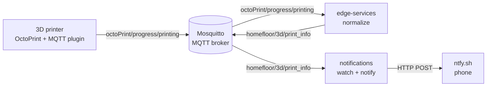

# Homefloor

Home-scale IIoT network via MQTT: a small "shop floor" at home.

Machines publish raw data to an MQTT broker, **edge services** turn it into
clean, project-specific messages, and **apps** subscribe to those messages and
react to them. The first machine is a 3D printer (Ender-3 V3 SE running
OctoPrint); the first app sends a phone notification when a print finishes.

## How it works



1. **OctoPrint** (with the [OctoPrint-MQTT](https://github.com/OctoPrint/OctoPrint-MQTT)
   plugin, base topic `octoPrint/`) publishes the printer's raw events.
2. **edge-services** subscribes to the raw topics it knows, parses them into
   small models and republishes them under `homefloor/...`.
3. **notifications** subscribes to the `homefloor/...` topics and sends a
   notification through [ntfy.sh](https://ntfy.sh) when something worth knowing
   happens.

Apps only ever depend on the `homefloor/...` topics, never on the raw machine
topics, so a machine or plugin can change without touching the apps.

## Services

### edge-services

Subscribes to raw machine topics and republishes normalized messages.

| Input topic                   | Output topic              | Model           |
| ----------------------------- | ------------------------- | --------------- |
| `octoPrint/progress/printing` | `homefloor/3d/print_info` | `PrintProgress` |

`homefloor/3d/print_info` payload (QoS 1):

```json
{
  "print_name": "Bottom_Hex_SM_PLA",
  "progress": 42,
  "timestamp": "2026-11-13T16:44:27+00:00"
}
```

`print_name` is the G-code file name without the `.gcode` extension and without
the slicer's trailing time-estimate suffix (`Bottom_Hex_SM_PLA_50m50s.gcode` →
`Bottom_Hex_SM_PLA`).

Non-JSON payloads are logged and skipped.

### notifications

Subscribes to the normalized topics and notifies via ntfy.sh.

| Notification     | Topic                     | Fires when        | Message                              |
| ---------------- | ------------------------- | ----------------- | ------------------------------------ |
| `print_finished` | `homefloor/3d/print_info` | `progress == 100` | `<print_name> finished printing at HH:MM` |

Retained messages are skipped, so restarting the service doesn't re-send old
notifications. Each notification can be switched on or off in its config file
(see below).

## Requirements

- An MQTT broker with username/password authentication (e.g. Mosquitto).
- OctoPrint with the MQTT plugin, pointed at the same broker, base topic `octoPrint/`.
- The [ntfy app](https://ntfy.sh) (or browser) to receive notifications.
- For development: Docker with Compose.

Docker is only the development setup. In production each service runs as a
standalone binary under systemd (see [Deployment](#deployment-planned)).

## Getting started (development)

```bash
cp .env.example .env    # then fill in the broker details
docker compose -f compose.dev.yml up --build
```

The dev images run each service under `watchfiles`, so saving a file in
`edge-services/` or `notifications/` restarts that service.

On first start, `notifications` prints the ntfy topic it publishes to:

```
ntfy.sh topic: homefloor-<random-id>
```

Subscribe to that topic in the ntfy app to get the notifications on your phone.

## Configuration

### Environment (`.env`)

Shared by both services:

| Variable        | Default | Description          |
| --------------- | ------- | -------------------- |
| `MQTT_HOST`     |         | Broker host or IP    |
| `MQTT_PORT`     | `1883`  | Broker port          |
| `MQTT_USER`     |         | Broker username      |
| `MQTT_PASSWORD` |         | Broker password      |

### Service config (`homefloor-data/`)

Each service keeps a JSON config in `~/.homefloor`, which Compose mounts from
`./homefloor-data`. The files are created with defaults on first start, and
missing fields are filled in automatically.

`edge-config.json`

| Field        | Default        | Description                                 |
| ------------ | -------------- | ------------------------------------------- |
| `mqtt_topic` | `homefloor/3d` | Prefix for the normalized topics it publishes |

`notifications-config.json`

| Field               | Default         | Description                                                    |
| ------------------- | --------------- | -------------------------------------------------------------- |
| `mqtt_topic`        | `homefloor/3d`  | Prefix of the normalized topics it subscribes to (keep equal to edge) |
| `ntfy_topic_prefix` | `homefloor`     | First part of the ntfy topic                                   |
| `ntfy_topic`        | random          | Second part; generated once if empty                           |
| `notifications`     | all `true`      | Enable or disable each notification by name                    |

The final ntfy topic is `<ntfy_topic_prefix>-<ntfy_topic>`. ntfy.sh topics are
public to anyone who knows the name, so keep the random part hard to guess.

## Logs

Both services log to `homefloor-data/` (`log-edge.txt`, `log-notifications.txt`),
rotated at 10 MB and kept for 14 days.

## Development

```bash
make fmt     # ruff check --fix + ruff format
make check   # lint and format check, no changes
```

### Adding a new normalized message

1. Write a parser in `edge-services/src/models_lib/` that returns a model with a
   `publish(client)` method.
2. Register the raw input topic in `PARSERS` in `edge-services/src/models.py`.

### Adding a new notification

1. Write a handler in `notifications/src/notification_lib/` that takes the
   decoded payload and calls `notify(...)`.
2. Register it in `NOTIFICATIONS` in `notifications/src/notifications.py` as
   `"name": (topic, handler)`. It is enabled by default and appears in
   `notifications-config.json`.

## Deployment (planned)

In production there is no Docker. Each service (edge-services, and every app
such as notifications) is built into its own standalone executable and runs as
its own systemd service on the host (e.g. the Raspberry Pi next to the broker).

| Service         | Binary                    | systemd unit                      |
| --------------- | ------------------------- | --------------------------------- |
| edge-services   | `homefloor-edge`          | `homefloor-edge.service`          |
| notifications   | `homefloor-notifications` | `homefloor-notifications.service` |

Each service is independent: it can be built, deployed, restarted and logged on
its own, and a crash in one app doesn't affect the others.

Example unit (`/etc/systemd/system/homefloor-edge.service`):

```ini
[Unit]
Description=Homefloor edge services
After=network-online.target mosquitto.service
Wants=network-online.target

[Service]
User=homefloor
EnvironmentFile=/etc/homefloor/homefloor.env
ExecStart=/usr/local/bin/homefloor-edge
Restart=on-failure
RestartSec=5

[Install]
WantedBy=multi-user.target
```

- `EnvironmentFile` holds the same variables as `.env` (`MQTT_HOST`, `MQTT_PORT`,
  `MQTT_USER`, `MQTT_PASSWORD`); keep it readable only by root and the service user.
- The service config and logs live in `~/.homefloor` of the service user
  (`/home/homefloor/.homefloor` with the unit above).
- Notifications use the same unit with its own binary and description.

```bash
sudo systemctl enable --now homefloor-edge homefloor-notifications
journalctl -u homefloor-edge -f
```

## Project layout

```
.
├── compose.dev.yml        # dev-only stack (both services, hot reload)
├── .env.example           # broker connection template
├── edge-services/
│   └── src/
│       ├── main.py        # MQTT subscribe → normalize
│       ├── models.py      # raw topic → parser registry
│       ├── models_lib/    # parsers + output models
│       └── normalizer/
├── notifications/
│   └── src/
│       ├── main.py        # MQTT subscribe → dispatch
│       ├── notifications.py   # name → (topic, handler) registry
│       ├── notification_lib/  # handlers
│       └── notify.py      # ntfy.sh client
└── homefloor-data/        # mounted as ~/.homefloor (configs + logs, git-ignored)
```

## Ideas / next steps

- More notifications: print failed or cancelled, printer error, etc.
- Production metrics for the printer: utilization, success rate, filament usage
- More machines and sensors

## License

[MIT](LICENSE)
